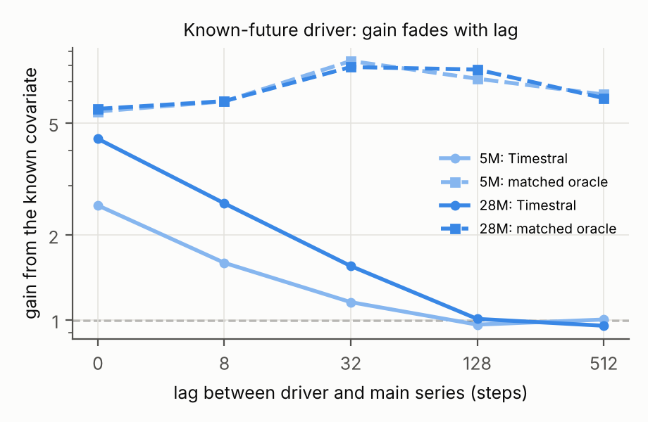

<!--
Writing rule for this file: every number must trace to a committed result file produced by a
committed script. Each number carries a pointer comment like <!-- src: results/... --> next to it.
Sections marked RESULTS-PENDING are filled only from those files.
-->

# 1. Introduction

Timestral is a family of open time-series foundation models (5M, 28M, 123M and 209M
parameters) released by Mistral on October 15, 2026. It forecasts up to 1,024 steps per
forward pass from up to 32,768 steps of history, outputs 21 quantiles per step, accepts
past-only and known-future covariates, and was pretrained mostly on synthetic data: simple
trend, seasonality and noise processes combined into multivariate series. Mistral reports
first place among pretrained and zero-shot models on GIFT-Eval, TIME and fev-bench.

A model trained on a synthetic distribution learns a prior over what series look like.
Benchmarks of real data measure how well that prior matches the series people happen to
collect. They do not say where the prior ends. This paper asks that question directly: we
build parameterized generators whose difficulty can be turned up smoothly, forecast them
with all four Timestral sizes, and measure the gap to forecasters that know the true
generating process. Then we look inside the model to explain the gaps, package the hard
cases as benchmarks, and test whether cheap fine-tuning closes them.

Contributions:

1. **A failure map** of Timestral across four signal families (chaos and dynamics, regime
   switches, heavy tails and fractal processes, and a learned mixture of primitives), along
   every difficulty knob, at four model sizes, four context lengths and horizons from 16
   steps to rollouts past one 1,024-step block, measured against a true-dynamics oracle and
   classical baselines.
2. **A covariate test** of Timestral's one-way covariate attention on coupled systems.
3. **A comparison of search methods** (CMA-ES, MAP-Elites quality-diversity, and gradient
   search through the model) for finding failures automatically.
4. **A mechanism analysis** with attention measurements on the forecast tokens and linear
   readouts of internal states.
5. **Two benchmarks** (a tagged diagnostic set and a leaderboard set) with generator code,
   seeds and a one-command evaluation.
6. **A fine-tuning study** comparing full fine-tuning, LoRA and data mixing under
   leave-one-family-out and held-out-knob protocols, with a regression check on normal series.

# 2. Setup

## 2.1 The model

Timestral is a causal patch transformer. A series is cut into patches of 32 steps; each
patch is normalized with the mean and standard deviation of everything observed up to the
end of that patch, squashed with `asinh`, and embedded. The sequence holds the context
patches followed by learned forecast tokens ("Decoupled Horizon Forecasting"): each forecast
token reads the whole context and the earlier forecast tokens, and a head maps it to 21
non-crossing quantiles for each of its 32 steps. Layers alternate attention over time with
attention across the variates of a series. Covariate rows are read by the main-series rows
but never read them. One forward pass covers up to 32 forecast patches (1,024 steps); longer
horizons are produced block by block, feeding each block's median back as context. The
released forecaster also averages the forecast of the series with the reflected forecast
of its negation ("symmetric averaging") and clips at zero when the context is non-negative.
We use the released code and weights with these defaults throughout.

Because a forecast block is causal across its forecast tokens, a forecast's first `h`
steps do not depend on the requested horizon beyond `h`. We checked that slicing a
1,024-step forecast reproduces separate shorter forecasts to float precision
(`tests/test_harness.py`), and evaluate all horizons up to the longest from one call.

## 2.2 References: what counts as a failure

A forecast error is only a failure relative to something that could have done better. We
use two references:

- **True-dynamics oracle.** Every generator is a simulator with an explicit state. To build
  a test case we simulate a warmup and the context, copy the final state 501 times, and
  advance every copy over the horizon with fresh noise. Copy 0 is the realized future; the
  other 500 form the oracle's predictive distribution, from which we take the same 21
  quantiles Timestral outputs. The oracle knows the equations, the parameters and the latent
  state at the forecast origin, so it is the best achievable forecast given that state (up
  to Monte Carlo error) and slightly stronger than anything that sees only the noisy
  observations. Deterministic systems get small dynamic noise and observation noise so the
  oracle's spread grows with the horizon instead of being zero.
- **Classical models.** Seasonal naive, ETS (additive error, damped trend, additive season
  when the period allows) and ARIMA (small order grid chosen by AIC), each turned into the
  same 21 quantiles from its Gaussian forecast distribution, fitted on the last 1,024 steps.

For every series we report the ratio of Timestral's error to the oracle's and to the best
classical model on that series, and the gap (difference) to the oracle.

## 2.3 Metrics

- **MASE**: mean absolute error of the median, divided by the in-sample mean absolute error
  of the seasonal naive forecast on the context.
- **sCRPS**: the continuous ranked probability score approximated by the average pinball
  loss over the 21 quantile levels (times 2), divided by the same scale as MASE.
- **Coverage and calibration**: the fraction of realized values inside the 80% and 98%
  intervals, and the mean absolute difference between each quantile level and the fraction
  of realized values below that quantile.
- **WQL** (GIFT-Eval's weighted quantile loss on levels 0.1 to 0.9), reported for the
  leaderboard only, since it divides by the series' magnitude and breaks near zero.

Ratios are aggregated over seeds by geometric mean, with 95% bootstrap intervals.

# 3. Signal families

Each family is a set of simulators with a difficulty knob (full definitions in
`otp/generators/`):

- **Chaos and dynamics**: Lorenz-63 (knob ρ through the onset of chaos; also the sampling
  interval), Rössler (knob c through period doubling), Mackey-Glass (knob: delay τ), the
  logistic map (knob r through the onset of chaos at about 3.57), and Kuramoto coupled
  oscillators (knob: coupling K through the synchronization threshold).
- **Regime switches**: jumps in mean, variance or seasonal frequency, placed inside the
  context at a chosen distance before the forecast origin or occurring in the horizon at a
  known hazard rate; and a Markov-switching AR process (knob: switching probability).
- **Heavy tails and fractal**: AR(1) and random walks with α-stable innovations (knob α),
  fractional Brownian motion (knob: Hurst exponent), a self-exciting (Hawkes) count process
  (knob: branching ratio), and a Markov-switching multifractal cascade (knob: number of
  multipliers).
- **Learned mixture of primitives**: a genome of four slots, each choosing one component
  (trend, season, AR noise, or any generator above), a weight, an additive or multiplicative
  role and three parameters, plus a global noise level (`otp/generators/mixture.py`). Search
  methods evolve genomes to maximize Timestral's error relative to the oracle while
  requiring the oracle to beat seasonal naive by a margin, so the series stays forecastable.
- **Controls**: in-prior series (random trend + season + AR noise, the kind of data Timestral
  was pretrained on).

# 4. Failure map

All ratios below are the geometric mean over seeds of Timestral's MASE divided by the
oracle's MASE on the same series, context and horizon (1.0 = as good as the true dynamics).
"vs best classical" divides by the best of seasonal naive, ETS and ARIMA on each series
instead. Unless stated otherwise: context 2,048 steps, horizon 128 steps, 8 seeds per setting.

## 4.1 Control: series like the training data

On random trend + season + AR-noise series (the kind Timestral was pretrained on), every size
stays within 0.99–1.15 of the oracle at horizons up
to 128 steps. The gap grows at long horizons:

| size | H=16 | H=128 | H=1024 | H=2048 |
|---|---|---|---|---|
| 5M | 1.02 | 1.06 | 1.42 | 2.15 |
| 28M | 0.99 | 1.03 | 1.30 | 2.25 |
| 123M | 0.99 | 1.01 | 1.12 | 1.36 |
| 209M | 1.00 | 1.02 | 1.16 | 1.57 |

Part of that long-horizon gap is not a prior failure: the oracle knows the exact trend slope
and seasonal shape, while any forecaster must estimate them from the context, and estimation
error in a slope grows linearly with the horizon. Family results are read against this control.

## 4.2 Chaos and dynamics

| series | 5M | 28M | 123M | 209M | 209M vs best classical |
|---|---|---|---|---|---|
| lorenz63/rho20 | 1.07 | 1.04 | 1.02 | 1.00 | 0.93 |
| lorenz63/rho28 | 1.31 | 1.28 | 1.27 | 1.24 | 0.95 |
| lorenz63/rho28_oe2 | 29.89 | 30.89 | 27.49 | 27.91 | 0.75 |
| rossler/c3 | 1.53 | 1.26 | 1.15 | 1.17 | 0.22 |
| rossler/c5.7 | 3.31 | 2.61 | 2.42 | 2.04 | 0.25 |
| rossler/c9 | 7.73 | 6.30 | 5.45 | 4.30 | 0.45 |
| mackey_glass/tau10 | 1.47 | 1.32 | 1.22 | 1.16 | 0.11 |
| mackey_glass/tau17 | 9.57 | 6.31 | 6.80 | 6.67 | 0.35 |
| mackey_glass/tau30 | 21.87 | 21.38 | 12.88 | 13.68 | 0.48 |
| logistic_map/r3.5 | 1.36 | 1.32 | 1.17 | 1.17 | 0.05 |
| logistic_map/r3.9 | 1.05 | 1.04 | 1.04 | 1.03 | 0.99 |
| kuramoto/K1 | 12.74 | 10.58 | 9.89 | 9.45 | 0.36 |
| kuramoto/K8 | 5.18 | 2.28 | 1.86 | 1.43 | 0.11 |

Timestral beats the best classical model on most of these systems (the 209M model's median
ratio to the best classical model across the chaos configs is
0.36) and is still far from the oracle on smooth, nearly
deterministic oscillators: Mackey-Glass with long delays (21.87 at 5M,
13.68 at 209M for τ = 30), weakly coupled Kuramoto oscillators
(12.74 and 9.45 at K = 1), and the Rössler system
(7.73 and 4.30 at c = 9). Size matters for some of these
and not others: strongly coupled Kuramoto goes from 5.18 at 5M to
1.43 at 209M, while the densely sampled Lorenz system stays at
29.89 (5M) and 27.91 (209M). The chaotic logistic map
(r = 3.9), whose predictability is gone after a few steps, stays near 1 at every size.

**The gap lives inside the predictability horizon.** A Lyapunov time is how long it takes a
small error in a chaotic system to grow by a factor of e (for Lorenz at ρ = 28 the exponent is
0.907 per time unit). Putting four sampling intervals of the same Lorenz system
on that common axis shows that the ratio is set by how many Lyapunov times the forecast
reaches, not by the step count:

| sampling step (time units) | horizon (steps) | horizon (Lyapunov times) | 209M MASE / oracle |
|---|---|---|---|
| 0.02 | 16 | 0.29 | 6.88 |
| 0.05 | 16 | 0.73 | 11.32 |
| 0.10 | 16 | 1.45 | 27.32 |
| 0.02 | 128 | 2.32 | 27.91 |
| 0.20 | 16 | 2.90 | 15.87 |
| 0.05 | 128 | 5.81 | 2.65 |
| 0.10 | 128 | 11.61 | 1.24 |
| 0.02 | 1024 | 18.58 | 1.22 |
| 0.20 | 128 | 23.22 | 1.18 |
| 0.02 | 2048 | 37.15 | 1.10 |
| 0.05 | 1024 | 46.44 | 1.09 |
| 0.10 | 1024 | 92.88 | 1.02 |
| 0.05 | 2048 | 92.88 | 1.06 |
| 0.10 | 2048 | 185.76 | 1.01 |
| 0.20 | 1024 | 185.76 | 1.02 |
| 0.20 | 2048 | 371.52 | 1.01 |

Inside one to three Lyapunov times the oracle can still track the trajectory and Timestral
cannot; past about ten, nobody can, and the ratio returns to about 1. The noise level of the
generator sets how good the oracle can be inside that window. Sweeping the noise level
(dynamic and observation noise together) shows how much of each ratio that choice sets:

| system | noise (% of scale) | 5M | 28M | 123M | 209M |
|---|---|---|---|---|---|
| lorenz63_rho28 | 0.10 | 1.96 | 1.89 | 1.87 | 1.83 |
| lorenz63_rho28 | 0.30 | 1.65 | 1.60 | 1.57 | 1.55 |
| lorenz63_rho28 | 1.00 | 1.48 | 1.47 | 1.44 | 1.44 |
| lorenz63_rho28 | 3.00 | 1.24 | 1.21 | 1.19 | 1.18 |
| lorenz63_rho28 | 10.00 | 1.11 | 1.09 | 1.07 | 1.07 |
| mackey_glass_tau17 | 0.10 | 75.47 | 64.81 | 56.19 | 43.93 |
| mackey_glass_tau17 | 0.30 | 22.32 | 18.29 | 12.69 | 12.68 |
| mackey_glass_tau17 | 1.00 | 6.32 | 5.75 | 4.84 | 4.32 |
| mackey_glass_tau17 | 3.00 | 2.71 | 2.60 | 2.25 | 2.14 |
| mackey_glass_tau17 | 10.00 | 1.76 | 1.81 | 1.48 | 1.46 |
| rossler_c5.7 | 0.10 | 17.33 | 15.70 | 12.84 | 11.77 |
| rossler_c5.7 | 0.30 | 10.57 | 9.80 | 7.90 | 6.78 |
| rossler_c5.7 | 1.00 | 2.51 | 2.32 | 2.12 | 1.97 |

At 0.1% noise the oracle is nearly exact and Mackey-Glass sits at
43.93–75.47 times its error; at 10% the gap is
1.46–1.81. The ratio is therefore a measure of how much
predictable structure Timestral leaves unused, and its size depends on how much predictable
structure the generator provides. The ordering of model sizes holds at every noise level.

## 4.3 Heavy tails and fractal processes

Across α-stable AR processes and random walks, fractional Brownian motion, Hawkes counts and
multifractal cascades, all four sizes stay between 0.94 and 1.34 of
the oracle:

| series | 5M | 28M | 123M | 209M | 209M vs best classical |
|---|---|---|---|---|---|
| tails/stable_ar/alpha2_rho0.9 | 1.00 | 1.01 | 1.00 | 1.00 | 1.03 |
| tails/stable_ar/alpha1.3_rho0.9 | 0.99 | 0.99 | 1.00 | 1.01 | 0.97 |
| tails/stable_ar/alpha1.3_rho1.0 | 1.08 | 1.34 | 1.09 | 1.13 | 1.14 |
| tails/fbm/H0.2 | 0.99 | 0.99 | 0.98 | 0.99 | 1.00 |
| tails/fbm/H0.8 | 1.17 | 1.20 | 1.26 | 1.15 | 0.76 |
| tails/hawkes/eta0.3 | 1.00 | 1.01 | 1.00 | 1.00 | 1.00 |
| tails/hawkes/eta0.95 | 1.06 | 1.03 | 1.03 | 1.04 | 1.09 |
| tails/msm/k8_ret | 1.00 | 1.00 | 1.00 | 1.00 | 1.00 |
| tails/msm/k8_cum | 1.03 | 1.07 | 1.02 | 1.00 | 1.04 |

Heavy tails and long memory, which a trend + season + Gaussian-noise description of series
does not cover, do not produce failures of the size seen for deterministic dynamics.

## 4.4 Regime switches

Three kinds of switch (a level jump, a change of seasonal period, a change of noise level) placed
a chosen number of steps before the forecast origin, so the context shows the switch:

| switch | size | 16 steps ago | 64 steps ago | 256 steps ago | 1024 steps ago |
|---|---|---|---|---|---|
| level +4 sd | 5M | 3.77 | 1.64 | 1.09 | 1.06 |
| level +4 sd | 209M | 2.43 | 1.06 | 1.02 | 1.02 |
| period x2 | 5M | 2.43 | 2.14 | 1.22 | 1.07 |
| period x2 | 209M | 2.38 | 1.84 | 1.10 | 1.04 |
| noise sd x0.25 | 5M | 1.35 | 1.41 | 1.16 | 1.11 |
| noise sd x0.25 | 209M | 1.06 | 1.16 | 1.05 | 1.03 |

The failure is concentrated right after a switch. Sixteen steps after a level jump of 4 noise
standard deviations, the error is 3.77 times the oracle's at 5M and
2.43 at 209M; a thousand steps later it is 1.06 and
1.02. Period changes last longer: 64 steps after the period triples, the
ratio is still 2.24 (5M) and 2.12 (209M). A direct measure of
how much of a level jump the forecast adopts (1 = forecasts at the new level, like the oracle;
0 = still at the old level), over the first 16 forecast steps and pooled over jump sizes, is
0.43 / 0.66 / 0.96 at 16 / 64 / 256 steps after the
switch for 5M and 0.49 / 0.70 / 0.93 for 209M.
Section 7.3 shows that the change is nevertheless represented inside the model.

When the switch happens during the horizon at a known rate (so nobody can see it coming),
Timestral stays at 0.93–1.06 of the oracle, and on
Markov-switching AR processes at 1.01–1.13.

## 4.5 Does more history help?

All four sizes with contexts up to 32,768 steps (Colab job B, 28 settings × 8 seeds):

| series | size | T=2048 | T=8192 | T=32768 |
|---|---|---|---|---|
| mackey_glass/tau17 | 5M | 9.09 | 6.91 | 6.47 |
| mackey_glass/tau17 | 209M | 4.91 | 4.54 | 3.84 |
| kuramoto/K1 | 5M | 15.26 | 13.86 | 13.74 |
| kuramoto/K1 | 209M | 9.47 | 8.10 | 7.62 |
| rossler/c5.7 | 5M | 2.83 | 2.59 | 2.49 |
| rossler/c5.7 | 209M | 2.23 | 2.10 | 2.06 |
| lorenz63/rho28 | 5M | 1.37 | 1.32 | 1.30 |
| lorenz63/rho28 | 209M | 1.25 | 1.21 | 1.19 |
| regime/mean_jump/context/delta4/d64 | 5M | 1.60 | 1.58 | 1.72 |
| regime/mean_jump/context/delta4/d64 | 209M | 1.08 | 1.10 | 1.13 |
| tails/fbm/H0.8 | 5M | 1.19 | 1.25 | 1.34 |
| tails/fbm/H0.8 | 209M | 1.10 | 1.13 | 1.26 |
| in_prior/p24 | 5M | 1.05 | 1.12 | 1.35 |
| in_prior/p24 | 209M | 1.03 | 1.02 | 1.12 |

More history helps on Mackey-Glass (τ = 17: 9.09 → 6.47
for 5M and 4.91 → 3.84 for 209M from 2,048 to
32,768 steps) and slightly on Rössler and Lorenz; it does not help on the in-prior control,
which gets slightly worse at 32,768 steps. 2 samples
(Rössler, c = 5.7) had oracle paths that left the attractor at long horizons; their oracle
ratios are excluded.

## 4.6 Real series that stand in for the families

Real data has no oracle, so it cannot show a gap to the best achievable forecast; it can show whether
the families' pattern against classical models carries over. We gathered open-license series
(sources, licenses and hashes in `bench/regression/sources.csv`; windows whose license does not allow
redistribution are kept out of git and rebuilt by `scripts/fetch_realdata.py`). On 412 windows
from GIFT-Eval and fev-bench datasets, Timestral's MASE relative to seasonal naive is 0.70 at 5M
and 0.65 at 209M (ETS 1.02, ARIMA 1.27; GIFT-Eval-style geometric mean over
dataset groups). These datasets may overlap Timestral's pretraining data.

A separate subset of 69 windows was picked as real analogues of the failure families:
sunspot numbers, lynx and hormone series and El Niño indices for delay feedback; grid frequency,
pedestrian counts and activity recordings for coupled oscillators; river discharge, earthquake counts,
financial and crypto series for heavy tails; macro and energy series with documented breaks, traffic
and COVID-19 cases for regime switches. The table compares Timestral's ratio to the best classical
model on these windows with the same ratio on the synthetic family (context 2,048, horizon 128):

| family | real windows | real 5M | synthetic 5M | real 209M | synthetic 209M |
|---|---|---|---|---|---|
| delay feedback | 12 | 0.92 | 0.39 | 0.73 | 0.26 |
| coupled oscillators | 19 | 0.79 | 0.44 | 0.78 | 0.20 |
| heavy tails | 15 | 0.90 | 1.02 | 0.87 | 1.01 |
| regime switches | 23 | 1.03 | 1.02 | 0.98 | 0.96 |

On the synthetic delay and oscillator systems Timestral beats the classical models by a wide margin
while staying far from the oracle (Section 4.2); on the real analogues its margin over classical models
is smaller. Heavy tails and regime switches sit near 1 on both. With no oracle on the real side, these
numbers do not say how far Timestral is from the best achievable forecast there.

# 5. Covariates and one-way attention

Timestral reads covariates as conditioning rows: the main series reads them, they never read the
main series. Several main rows given together read each other both ways. We built six coupled
systems with known equations (`otp/generators/coupled.py`): an exogenous driver whose past sets the
main series after a lag (LaggedDriver), the same through a nonlinearity (NonlinearDriver), linear and
predator-prey feedback loops, a hidden driver seen through a noisy proxy (HiddenDriver), and a
known-future covariate that is a noisy copy of the main series shifted by one step (LeakyKnown). The
main series is forecast four ways: alone, with the other channel as a past-only covariate, as a
known-future covariate where that makes sense, and as a second main row ("joint"). The oracle is
matched to the information each condition gives. Sizes 5M and 28M ran on the full grid (5 knob values,
8 seeds, horizons 16 / 128 / 1,024); 123M and 209M on a reduced grid (3 knob values, 4 seeds, horizons
16 / 128), so the oracle gains below differ slightly between the two pairs of sizes. Details and all
tables: `results/covariates/README.md`.

**Past covariates are used partly, and more with size.** When the driver's past determines the main
series over the whole horizon, a forecaster that used it fully would cut the error several-fold. Each
cell below gives Timestral's covariate gain (MASE alone / MASE with the past covariate) and the matched
oracle's gain, at context 2,048 and horizon 16:

| system | knob | 5M | 28M | 123M | 209M |
|---|---|---|---|---|---|
| LaggedDriver | lag 32 | 1.07 / 8.26 | 1.66 / 7.86 | 2.10 / 7.92 | 2.41 / 7.95 |
| NonlinearDriver | nonlinearity 0.5 | 1.09 / 6.73 | 1.62 / 6.48 | 1.81 / 5.23 | 2.04 / 4.92 |
| HiddenDriver | x noise 0.05 | 1.03 / 5.53 | 1.20 / 5.31 | 1.78 / 4.35 | 1.77 / 4.35 |

At lag 32, 209M reaches a gain of 2.41 out of 7.95 available.

**Known-future covariates help only when the relation is immediate.** With the driver's future given,
the 28M gain on LaggedDriver falls from 4.39 at lag 0 to 0.95 at lag 512, while the
matched oracle's gain stays at 5.62–7.91 (horizon 16):

| lag | 5M gain | 5M oracle gain | 28M gain | 28M oracle gain |
|---|---|---|---|---|
| 0 | 2.55 | 5.50 | 4.39 | 5.62 |
| 8 | 1.59 | 5.97 | 2.59 | 5.98 |
| 32 | 1.15 | 8.31 | 1.55 | 7.91 |
| 128 | 0.96 | 7.19 | 1.01 | 7.75 |
| 512 | 1.00 | 6.32 | 0.95 | 6.13 |

When the known covariate is the main series itself, one step late with small noise (LeakyKnown at
noise ratio 0.05), Timestral's error is several times the oracle's that reads it (MASE over matched-oracle
MASE):

| size | H=16 | H=128 | H=1024 |
|---|---|---|---|
| 5M | 8.47 | 20.92 | 42.71 |
| 28M | 3.81 | 9.94 | 38.41 |
| 123M | 3.04 | 3.70 | – |
| 209M | 3.25 | 2.89 | – |

**One-way routing is not the bottleneck.** Giving the same channel as a second main row (two-way
attention) instead of a past covariate (one-way) changes the error little: joint/past-covariate MASE is
within 0.95–1.05 in 95% of the 252 system × knob × size × horizon cells.
Among the cells whose 95% interval lies below 1, two-way routing gains most on NonlinearDriver
with the nonlinearity off (123M; `results/covariates/summary.csv`), the predator-prey loop
(0.81, 95% interval 0.69–0.96) and
LaggedDriver (0.83, 0.72–0.92); on the linear feedback loop
the ratio stays within 0.98–1.01. The gap to the oracle comes from how much
of the covariate's information is used at all, not from which way it is routed.

# 6. Searching for failures

Sections 4 and 5 test failure families we chose by hand. Here a search procedure chooses. The search space
is the mixture-of-primitives generator (`otp/generators/mixture.py`): a genome of numbers in [0, 1] decodes
into four component slots (each a trend, season or noise piece, or one of the chaos, regime, heavy-tail or
fractal generators, with a weight, a mode of combination and its own parameters) plus an observation-noise
level. Every genome is a simulator with an exact Monte Carlo oracle, so every candidate can be scored as in
Section 4.

**Objective.** The fitness of a genome is the geometric mean, over a few fixed seeds, of MASE(Timestral-5M) /
MASE(oracle) at context 2,048 and horizon 128 (`otp/search/objective.py`). A genome counts only if the series
it makes is forecastable by the oracle: the oracle's sCRPS must be well below seasonal naive's on the same
samples (a fixed fraction set in the objective), values must be finite and of sane scale. Infeasible genomes
score zero. Every Timestral forward call is counted, and results are cached by genome.

**Methods, at equal budget.** Each method gets the same number of Timestral calls and three search seeds.
(1) CMA-ES over the bounded genome. (2) MAP-Elites, a quality-diversity search: two behaviour descriptors (the
dominant component family and a spectral statistic of the context) define a grid of cells, and each cell keeps
its best genome, so the archive covers different kinds of failure instead of one peak. (3) Gradient search:
a differentiable re-implementation of part of the generator (sinusoids, trend, AR noise with fixed noise
draws, a smooth regime gate) is pushed by gradients through Timestral's differentiable forward pass to raise
its pinball loss above the oracle's; the final parameters are then scored with the standard pipeline, so all
three methods are compared on the same metric. A separate input-space study finds, for in-prior series, the
smallest perturbation of the context that doubles Timestral's MASE on a fixed future; it measures sensitivity,
not a generator failure, since the oracle is unaffected.

*(Results pending: `results/search/comparison.csv` is not in the repository yet.)*

**Transfer.** The top elites of each method are re-scored on 28M, 123M and 209M with fresh seeds, to see whether
failures found on the smallest model are failures of the family or of one size.

*(Results pending: `results/search/transfer.csv` is not in the repository yet.)*

# 7. Why it fails

## 7.1 Two suspects that turned out innocent

**Symmetric averaging.** The released forecaster averages its forecast of the series with the
mirrored forecast of the negated series. That forces a symmetric treatment of asymmetric
processes (bursty counts, one-sided maps), so it was a natural suspect. Turning it off changes
the sCRPS ratio to the oracle by a factor between 0.991 and 1.069
across 14 settings and both small sizes: it is not where the failures come from.

**Cumulative normalization.** Timestral normalizes every patch with the mean and spread of
everything since the start of the context, so old history keeps weighing on the scale after a
regime switch. After a variance drop 64 steps back, intervals are indeed far too wide (80%
intervals cover at least 0.997 of points; sCRPS ratio
1.59–1.75). But cutting the context down to
the post-switch part, which removes the old history from the statistics entirely, lowered the
sCRPS ratio in only 12 of 44 cells (those with at least
256 post-switch steps) and raised it in the rest. The anchoring is not the main cause.

## 7.2 Template or retrieval?

For a deterministic system, the context itself is a library of past trajectories: find the
moments whose recent history looks most like the present and see what happened next (the
"method of analogues", a few lines of nearest-neighbour code with no training). A second
context-only forecaster continues the series as a periodic pattern (the average of its last
cycles at the dominant period). On the chaos family (MASE, lower is better):

| series | oracle | analog | template | 5M | 28M | 123M | 209M |
|---|---|---|---|---|---|---|---|
| mackey_glass/tau17 | 0.29 | 0.93 | 3.85 | 2.79 | 1.84 | 1.98 | 1.95 |
| mackey_glass/tau30 | 0.28 | 2.20 | 9.93 | 6.10 | 5.96 | 3.59 | 3.81 |
| rossler/c5.7 | 0.48 | 0.81 | 2.02 | 1.59 | 1.25 | 1.16 | 0.98 |
| rossler/c9 | 0.43 | 1.25 | 3.98 | 3.33 | 2.71 | 2.34 | 1.85 |
| kuramoto/K1 | 0.20 | 3.54 | 3.96 | 2.61 | 2.17 | 2.03 | 1.94 |
| kuramoto/K8 | 0.06 | 0.08 | 0.87 | 0.32 | 0.14 | 0.12 | 0.09 |
| lorenz63/rho28 | 1.44 | 1.97 | 2.20 | 1.89 | 1.84 | 1.83 | 1.79 |
| logistic_map/r3.9 | 0.54 | 0.56 | 0.58 | 0.56 | 0.56 | 0.56 | 0.56 |

The method of analogues beats every Timestral size on Mackey-Glass and Rössler and loses to
Timestral on weakly coupled Kuramoto and on Lorenz. Timestral's forecasts correlate more with the analogue forecast
than with the periodic template, but lean toward the template more than the oracle does
(`results/mechanism/analog/summary.csv`). Our reading: Timestral uses the context partly as a
trajectory library and partly as a pattern to repeat, and on smooth nonlinear oscillators,
which its trend + season + noise prior represents as near-periodic, the second pull wins.

## 7.3 Inside the model: represented but not used

For each setting we ran one plain forward pass on 300 samples and asked two questions about
the oracle's expected change over the first forecast patch (and at single steps 1 and 16):
how well does Timestral's own forecast predict it, and how well does a linear readout (a
ridge regression, cross-validated) of the hidden state of the first forecast token predict
it, at the best layer? If the readout does much better than the output, the information the
oracle uses is inside the model but does not reach the forecast. The readout is a lower bound
on what is linearly present: with 300 samples and 192–768 features per token, the ridge fit
loses some signal, which shows on the in-prior control, where it scores
0.784–0.832 against 0.996–0.997
for the output. Gaps in the readout's favour are therefore conservative.

| setting | size | MASE / oracle | output R2 | best readout R2 | step-1 output R2 | step-1 readout R2 |
|---|---|---|---|---|---|---|
| mean_jump_d 16 | 5M | 3.624 | 0.670 | 0.956 | 0.540 | 0.796 |
| mean_jump_d 16 | 209M | 2.476 | 0.726 | 0.980 | 0.584 | 0.865 |
| mean_jump_d 64 | 5M | 1.536 | 0.919 | 0.962 | 0.803 | 0.841 |
| mean_jump_d 64 | 209M | 1.121 | 0.966 | 0.985 | 0.905 | 0.872 |
| mean_jump_d 256 | 5M | 1.087 | 0.977 | 0.965 | 0.899 | 0.850 |
| mean_jump_d 256 | 209M | 1.026 | 0.993 | 0.985 | 0.951 | 0.924 |
| freq_jump_d 64 | 5M | 2.269 | 0.894 | 0.960 | 0.084 | 0.684 |
| freq_jump_d 64 | 209M | 1.856 | 0.966 | 0.978 | 0.227 | 0.756 |
| freq_jump_d 1024 | 5M | 1.044 | 0.997 | 0.961 | 0.894 | 0.787 |
| freq_jump_d 1024 | 209M | 1.024 | 0.997 | 0.978 | 0.931 | 0.890 |
| mackey_tau 17 | 5M | 7.258 | 0.992 | 0.999 | 0.956 | 0.971 |
| mackey_tau 17 | 209M | 4.855 | 0.998 | 1.000 | 0.984 | 0.983 |
| lorenz_rho 28 | 5M | 1.415 | 0.772 | 0.781 | 0.724 | 0.721 |
| lorenz_rho 28 | 209M | 1.346 | 0.869 | 0.881 | 0.972 | 0.962 |
| in_prior 24 | 5M | 1.070 | 0.996 | 0.784 | 0.958 | 0.666 |
| in_prior 24 | 209M | 1.027 | 0.997 | 0.828 | 0.989 | 0.769 |

**Recent regime switches: represented, attended to, not used.** Sixteen steps after a mean
jump, the readout reaches R² 0.956–0.980 at every size while
the forecast itself reaches 0.570–0.726, and the forecast
error is 2.02–3.62 times the oracle's. The forecast
tokens are not looking elsewhere: they put 15.70–17.69
times their proportional share of attention on the post-switch patches. Sixty-four steps
after a frequency jump, one step ahead, the readout reaches 0.684–0.775
against 0.084–0.227 for the output. By 256 steps after
a mean jump the two agree (0.977–0.993 vs.
0.965–0.985). The model sees and encodes a recent change and
then forecasts as if it may not last. Our interpretation, which we cannot check without the
pretraining data: if lasting breaks are rare in the synthetic trend + season + noise mix, a very
recent departure from the pattern is better explained as noise under that prior than as a new
regime.

**Deterministic oscillators: the gap builds later.** On Mackey-Glass (τ = 17) output and readout
agree for the first patch (0.992–0.998 vs.
0.999–1.000): the near-term forecast uses what is there, and the
error accumulates over the following cycles. There the forecast correlates with a periodic
continuation of the context more than the oracle's forecast does
(0.87 at 5M, 0.81 at 209M, against
0.751 for the oracle), and the excess shrinks with size together with the error.

# 8. A neuron atlas

Section 7 looked at a few readouts and attention patterns. This section looks at every MLP neuron of every
size. Timestral's MLP is SwiGLU, so a neuron's value (gate times up-projection) takes both signs; each neuron
is studied as two poles, one per sign.

**Corpus.** A labelled corpus of series from the project's generators: in-prior trend, season and noise with
controlled parameters, and the chaos, regime, tails and mixture families. For every series the generating
variables are stored, and for every 32-step patch the patch-level variables that can be computed exactly from
the simulator: local level, slope and noise, seasonal phase, regime indicator, steps since the last switch,
whether the patch holds an outlier, and the oracle's one-step predictability. A seeded split of series is
held out and never used for labelling. A mixed-domain set of open-license real windows is added for a
transfer test (`results/neurons/real/`).

**Labels.** For each pole, the known variable (or simple input motif) that best explains its activation on the
tokens where that pole is active is found by mutual information and cross-validated linear readout R²
(single variable and best pair). Each pole stores its best label, score, runner-up and the gap between them.

**One job or many.** A pole has one main job if its best single label explains at least a fraction θ of the
explainable variance, and is unexplained if no label clears a floor. The fractions of one-job, mixed and
unexplained poles are reported as curves over θ, per layer and size, never at a single threshold.

| size | live poles | one job | 95% low | 95% high | one job, held-out series | mixed | unexplained |
|---|---|---|---|---|---|---|---|
| 5M | 8188 | 0.045 | 0.041 | 0.050 | 0.041 | 0.834 | 0.121 |
| 28M | 24566 | 0.029 | 0.026 | 0.031 | 0.024 | 0.830 | 0.142 |
| 123M | 68463 | 0.027 | 0.026 | 0.028 | 0.022 | 0.813 | 0.160 |
| 209M | 98273 | 0.023 | 0.022 | 0.024 | 0.019 | 0.811 | 0.165 |

Against this variable library, few poles are single-variable: at θ = 0.7 the one-job share is
4.5% at 5M and 2.3% at 209M, and most poles are mixed (83% and
81%). This number depends on the corpus as much as on the neurons. Scored the same way on
corpora of shorter and longer contexts (same generator recipe), the one-job share is
24–47%, and only 12–55% of poles keep the
best label they had on the main corpus:

| corpus | size | one job | unexplained | mean E | same label as main |
|---|---|---|---|---|---|
| main | 5M | 0.045 | 0.121 | 0.257 | 1.000 |
| main | 209M | 0.023 | 0.165 | 0.212 | 1.000 |
| short | 5M | 0.415 | 0.240 | 0.209 | 0.212 |
| short | 209M | 0.308 | 0.457 | 0.136 | 0.234 |
| long | 5M | 0.242 | 0.314 | 0.189 | 0.551 |
| long | 209M | 0.242 | 0.418 | 0.153 | 0.547 |
| xlong | 5M | 0.475 | 0.380 | 0.164 | 0.198 |
| xlong | 209M | 0.431 | 0.444 | 0.146 | 0.122 |

The main corpus has the largest explainable ceiling E (more of each pole's variance is explained by
combinations of variables), which lowers every single-variable ratio. A control separates the possible causes
(`results/neurons/followup/`). On the univariate part of the main corpus (5M: 4.8% one-job with the full library), restricting
the library to the variables defined in all four corpora gives 4.8%, and random libraries of 10 to 50
variables give 3.2–7.2%. Subsampling the main corpus to fewer series raises it:
11–12% with 1,034 series and 26–37% with 48, with E
falling and the labels drifting away from the full-corpus ones:

| size | corpus | series | library | runs | one job (mean) | min | max | mean E | same label as reference |
|---|---|---|---|---|---|---|---|---|---|
| 5M | long | 620 | common | 1 | 0.226 | 0.226 | 0.226 | 0.193 | 0.516 |
| 5M | main | 3100 | common | 1 | 0.048 | 0.048 | 0.048 | 0.262 | 0.989 |
| 5M | main | 3100 | full | 1 | 0.048 | 0.048 | 0.048 | 0.262 | 1.000 |
| 5M | main | 1034 | full | 3 | 0.115 | 0.111 | 0.122 | 0.214 | 0.788 |
| 5M | main | 620 | full | 3 | 0.264 | 0.262 | 0.266 | 0.156 | 0.731 |
| 5M | main | 48 | full | 3 | 0.326 | 0.257 | 0.374 | 0.124 | 0.297 |
| 5M | short | 1034 | common | 1 | 0.408 | 0.408 | 0.408 | 0.211 | 0.194 |
| 5M | xlong | 48 | common | 1 | 0.474 | 0.474 | 0.474 | 0.164 | 0.172 |
| 28M | main | 3100 | common | 1 | 0.032 | 0.032 | 0.032 | 0.232 | 0.982 |
| 28M | main | 3100 | full | 1 | 0.032 | 0.032 | 0.032 | 0.233 | 1.000 |
| 28M | main | 1034 | full | 1 | 0.103 | 0.103 | 0.103 | 0.182 | 0.768 |
| 28M | main | 48 | full | 1 | 0.303 | 0.303 | 0.303 | 0.116 | 0.231 |

So the number of series raises the share: with fewer series the cross-validated ceiling E shrinks and
single-variable ratios rise. Series count does not explain all of the corpus differences, though. The short
corpus (1,034 series of 128 steps) gives 41% against
11–12% for the main corpus cut to the same number of series, and the long corpus
(620 series of 4,096 steps) gives 23%, below the 26–27% of the main
corpus cut to 620 series; history length (tokens per series) and the corpus recipe matter too. Within the main
corpus the share was still falling between 1,034 and 3,100 series, so the main-corpus value is an upper bound
on what a larger corpus of the same kind would give. We report it as "against known generating variables, few poles are single-variable",
and do not report it as evidence that the neurons are polysemantic in general. A label space that is not fixed in advance (for example motif shapes named from
the exemplars, as interpretability work on language models does) could give a different answer.

**Checks.** Predictive: on the held-out series, each pole's activation is predicted from its label alone and
the held-out R² is compared with the labelling-set score. Causal: for a stratified sample of poles, the pole is
scaled during the forward pass and the change in the forecast is compared with a prediction written down, and
committed, before any steering run (`results/neurons/steering_preregistration.md`).

| size | poles | n | matched | match rate | 95% high | monotone share |
|---|---|---|---|---|---|---|
| 123M | labeled | 68 | 0 | 0.000 | 0.053 | 0.574 |
| 123M | complement | 26 | 0 | 0.000 | 0.129 | 0.500 |
| 123M | control | 432 | 0 | 0.000 | 0.009 | 0.486 |
| 209M | labeled | 63 | 0 | 0.000 | 0.057 | 0.603 |
| 209M | complement | 20 | 0 | 0.000 | 0.161 | 0.650 |
| 209M | control | 432 | 0 | 0.000 | 0.009 | 0.521 |
| 28M | labeled | 47 | 0 | 0.000 | 0.076 | 0.532 |
| 28M | complement | 20 | 0 | 0.000 | 0.161 | 0.600 |
| 28M | control | 432 | 0 | 0.000 | 0.009 | 0.481 |
| 5M | labeled | 25 | 0 | 0.000 | 0.133 | 0.320 |
| 5M | complement | 11 | 0 | 0.000 | 0.259 | 0.364 |
| 5M | control | 432 | 5 | 0.012 | 0.027 | 0.449 |

No labeled pole matched its prediction, and scaling a single pole (up to four times, or to zero) moved the
forecast by at most 0.041 context standard deviations over all 203 steered labeled
poles. Whether that null result says anything depends on whether the test can detect a real effect, so a
follow-up (pre-registered in `results/neurons/steering_preregistration_followup.md`, results in
`results/neurons/followup/`) added a positive control. A ridge readout direction for the local level was fitted
on the residual stream at an early, a middle and a late block, and the stream was pushed along it by a known
amount; the effect on the forecast was judged with the same quantities and the same criterion as the pole
steering:

| size | level cells | pre-registered match | calibrated match | largest gain | noise direction, late block: effect | matches |
|---|---|---|---|---|---|---|
| 5M | 18 | 3 | 9 | 0.349 | 0.157 | 1 |
| 28M | 18 | 2 | 11 | 0.101 | 0.056 | 1 |
| 123M | 18 | 0 | 8 | 0.022 | 0.054 | 1 |
| 209M | 18 | 0 | 7 | 0.017 | 0.063 | 1 |

At 5M and 28M the positive control is detected (3 and 2 of 18 level cells match;
largest gains 0.349 and 0.101), so at those sizes the single-pole null result is informative: a
pole effect of the size the criterion asks for would have been seen. At 123M and 209M no level cell matches
(largest gains 0.022 and 0.017): pushing the level readout moves the forecast very little,
and under the pre-registered rule the test is insensitive there, so the single-pole null result at those sizes
says nothing either way. (The noise direction at the late block does reach the spread threshold at every size,
by a small margin.) A calibrated criterion, which counts an effect as large when it beats 95% of matched random
controls, matches 7–11 level cells per size, but at 123M and 209M it fires on effects well below the
original thresholds; it is only meaningful next to the minimum detectable effects in `followup/mde.csv`.

Steering whole groups (the top 8, 32 or 128 poles of one label, scaled together) moves the forecast more:

| size | k | groups | labeled, pre-registered | random, pre-registered | labeled, calibrated | random, calibrated |
|---|---|---|---|---|---|---|
| 123M | 8 | 35 | 0.000 | 0.000 | 0.371 | 0.032 |
| 123M | 32 | 28 | 0.036 | 0.000 | 0.214 | 0.022 |
| 123M | 128 | 18 | 0.056 | 0.000 | 0.389 | 0.035 |
| 209M | 8 | 37 | 0.000 | 0.000 | 0.324 | 0.015 |
| 209M | 32 | 29 | 0.069 | 0.004 | 0.517 | 0.028 |
| 209M | 128 | 24 | 0.125 | 0.003 | 0.500 | 0.018 |
| 28M | 8 | 30 | 0.033 | 0.002 | 0.267 | 0.033 |
| 28M | 32 | 22 | 0.182 | 0.003 | 0.364 | 0.034 |
| 28M | 128 | 5 | 0.200 | 0.025 | 0.200 | 0.037 |
| 5M | 8 | 27 | 0.111 | 0.005 | 0.148 | 0.028 |
| 5M | 32 | 10 | 0.200 | 0.056 | 0.200 | 0.031 |
| 5M | 128 | 1 | 0.000 | 0.250 | 0.000 | 0.062 |

At most 20% of labeled groups match the pre-registered criterion at any size and group size. Under the calibrated
criterion, labeled groups match in 0.15–0.52 of cases against 0.015–0.035 for random
groups of the same size (cells with at least 10 labeled groups; 2 cells at 5M and 28M with k = 128 rest on
1 to 5 groups). Groups of same-label poles push the forecast in the labelled direction more often than random
groups do, mostly by amounts below the original thresholds.

**Motif labels.** As an essay-style comparison without a fixed variable list, each pole's top exemplar
patches were assigned to 16 shape clusters fitted on all exemplars; a pole is motif-cohesive when most of
its top exemplars share one cluster. The fixed naming rule calls 12 of the 16 clusters "oscillation", so
clusters are reported by number. The follow-up pre-registered that the higher one-job share on small corpora
would come with tighter motifs; the data contradict it:

| size | series | seeds | one job (theta 0.7) | motif-cohesive |
|---|---|---|---|---|
| 5M | 3100 | 1 | 0.048 | 0.142 |
| 5M | 1034 | 3 | 0.115 | 0.117 |
| 5M | 620 | 3 | 0.264 | 0.107 |
| 5M | 48 | 3 | 0.326 | 0.068 |
| 28M | 3100 | 1 | 0.032 | 0.129 |
| 28M | 1034 | 3 | 0.104 | 0.107 |
| 28M | 620 | 3 | 0.256 | 0.100 |
| 28M | 48 | 3 | 0.278 | 0.064 |
| 123M | 3100 | 1 | 0.030 | 0.108 |
| 123M | 1034 | 3 | 0.101 | 0.088 |
| 123M | 620 | 3 | 0.241 | 0.082 |
| 123M | 48 | 3 | 0.246 | 0.058 |
| 209M | 3100 | 1 | 0.026 | 0.107 |
| 209M | 1034 | 3 | 0.093 | 0.088 |
| 209M | 620 | 3 | 0.229 | 0.082 |
| 209M | 48 | 3 | 0.238 | 0.060 |

On the full main corpus 0.11–0.14 of poles are motif-cohesive and 0.026–0.048 are one-job; with 48
series motif cohesion falls to 0.06–0.07 while the one-job share rises to 0.24–0.33. The higher
one-job share of small corpora is therefore not a sign of more specialised neurons; it is another indication that
the share is an upper bound set by how the corpus was built.

**Link to the failure map.** Which poles are active on the Mackey-Glass, Rössler and Kuramoto contexts where
Timestral falls behind the oracle, whether seasonal or periodic-pattern poles are among them, and whether
damping them moves the forecast toward the oracle or toward the analogue forecaster of Section 7.2.

| size | chaos-label enrichment among elevated poles | MASE ratio before | after ablating periodic poles | after ablating random poles |
|---|---|---|---|---|
| 5M | 2.487 | 1.850 | 1.850 | 1.851 |
| 28M | 2.072 | 1.754 | 1.759 | 1.755 |
| 123M | 1.957 | 1.685 | 1.688 | 1.683 |
| 209M | 2.017 | 2.050 | 2.050 | 2.053 |

Poles with chaos-related labels are over-represented among the poles that are more active on failing chaos
contexts than on reference contexts, at every size. Ablating the elevated poles with periodic labels leaves
the forecast's error ratio essentially where it was, as does ablating as many random poles in the same layers:
the periodic-template behaviour of Section 7.2 is not carried by a small set of neurons that can be switched off.

# 9. Benchmarks

The failure map is released as two benchmark sets built from the same simulators (code and data in
`bench/`). Each series comes with the oracle's 21 quantiles, so a model is scored against the best
achievable forecast as well as against seasonal naive, the GIFT-Eval convention.

**OffPrior-Diag** has 372 series: 31 configs with 12 seeds each, at
context 2,048 and horizon 128. Every config was picked to cover one failure type from Sections 4 and 7,
or to serve as a control (inside the prior, an old switch, a switch inside the horizon that nobody can
see coming, a map nobody can forecast); each series carries its failure type and a one-line reason.
**OffPrior-LB** has 3,776 series: every config of the chaos, regime, tails and in-prior
grids, 40 fixed random mixture genomes and four more in-prior periods (236 configs), 16 seeds per config spread
over contexts 512 / 2,048 / 8,192 and horizons 16 / 128 / 1,024, split into public and held-out halves by
seed parity. The seeds and code are public, so the held-out half is a convenience, not a secret test set.
`bench/eval.py` scores one model in one command; the summary is the geometric mean over series of MASE
and sCRPS divided by seasonal naive's, and of MASE divided by the oracle's.

| model | series | MASE / seasonal naive | sCRPS / seasonal naive | MASE / oracle | 80% coverage |
|---|---|---|---|---|---|
| oracle | 372 | 0.272 | 0.209 | 1.000 | 0.789 |
| timestral-209M | 372 | 0.543 | 0.427 | 2.002 | 0.781 |
| timestral-123M | 372 | 0.550 | 0.435 | 2.028 | 0.771 |
| timestral-28M | 372 | 0.607 | 0.478 | 2.239 | 0.751 |
| timestral-5M | 372 | 0.656 | 0.515 | 2.417 | 0.705 |
| ets | 372 | 1.213 | 1.190 | 4.468 | 0.875 |
| arima | 372 | 1.123 | 0.872 | 4.150 | 0.738 |
| seasonal_naive | 372 | 1.000 | 1.000 | 3.679 | 0.814 |

| model | series | MASE / seasonal naive | sCRPS / seasonal naive | MASE / oracle | 80% coverage |
|---|---|---|---|---|---|
| oracle | 3776 | 0.463 | 0.286 | 1.000 | 0.798 |
| timestral-209M | 3776 | 0.608 | 0.385 | 1.314 | 0.793 |
| timestral-123M | 3776 | 0.615 | 0.389 | 1.329 | 0.791 |
| timestral-28M | 3776 | 0.637 | 0.402 | 1.375 | 0.783 |
| timestral-5M | 3776 | 0.669 | 0.425 | 1.446 | 0.779 |
| ets | 3776 | 1.006 | 0.926 | 2.172 | 0.889 |
| arima | 3776 | 1.039 | 0.663 | 2.245 | 0.770 |
| seasonal_naive | 3776 | 1.000 | 1.000 | 2.159 | 0.882 |

On OffPrior-Diag, Timestral's MASE is 2.00× the oracle's at 209M and
2.42× at 5M, against 4.47× for ETS,
4.15× for ARIMA and 3.68× for seasonal naive.
On OffPrior-LB the same ratios are 1.31× and 1.45× for Timestral,
and 2.17×, 2.24× and
2.16× for the classical models. By family on OffPrior-LB, 209M is at
2.16× the oracle on chaos, 1.47× on the mixture genomes and
1.01× on tails.

| failure type | series | 209M MASE / oracle | 209M MASE / seasonal naive |
|---|---|---|---|
| bursty | 12 | 0.991 | 0.938 |
| chaos_short_reach | 24 | 4.455 | 0.699 |
| control_in_prior | 60 | 1.007 | 0.699 |
| control_old_switch | 12 | 1.016 | 0.745 |
| control_unknowable | 12 | 0.978 | 0.804 |
| control_unpredictable | 12 | 1.033 | 0.764 |
| coupled_oscillators | 36 | 7.942 | 0.177 |
| delay_oscillator | 36 | 6.515 | 0.223 |
| heavy_tail_walk | 12 | 1.006 | 1.011 |
| long_memory | 12 | 1.123 | 0.643 |
| multifractal | 12 | 1.033 | 1.037 |
| periodic_map | 12 | 1.187 | 0.046 |
| recent_switch | 84 | 1.808 | 1.074 |
| smooth_chaos | 24 | 2.875 | 0.273 |
| switching | 12 | 1.090 | 0.753 |

By failure type, the diagnostic set reproduces the map at 209M: coupled oscillators
(7.94×), delay oscillators (6.52×), chaos within the
first Lyapunov times (4.46×), smooth chaos (2.87×) and
recent switches (1.81×), while the controls and the heavy-tailed, bursty and
multifractal types stay at 0.98–1.03×.

The published files were built on a Windows laptop. A rebuild on Linux with newer NumPy matched them
array-for-array for 25 of 31 diagnostic configs; in the others
(Mackey-Glass, Kuramoto near synchronization, and one fractional Brownian motion setting) platform
floating-point differences change the simulated paths, and the chaotic ones diverge. Scores should
therefore be reported on the published files (`bench/data/cross_platform_diag.json` has the per-config
comparison).

# 10. Fixing it

## 10.1 Without training: let the context decide

Section 7.2 showed that a nearest-neighbour forecaster built from the context beats Timestral
on some deterministic systems and loses badly on others. A forecaster can find out which case
it is in from the context alone: forecast the last stretch of the context from what comes
before it, with both methods, and compare. The rule we test switches to the analogue forecast
(keeping Timestral's quantile spread around the new median) only when the analogues' backtest
error is below 0.7 times Timestral's on each of the last two 128-step windows.

How the rule was chosen matters. A first pre-set procedure (tune on even seeds, report on odd
seeds) picked a one-window rule that helped chaos but cost the tails family
1.031–1.043 on the held-out seeds. We then
picked the two-window rule from that held-out table, which is a choice made after seeing
it, so we froze it and evaluated it once more on fresh samples generated for that purpose
(`results/fix/README.md` lists all three stages). On the fresh samples (MASE of the fix divided
by Timestral's MASE; below 1 is better):

| family | 5M | 28M | 123M | 209M | share switched (range over sizes) |
|---|---|---|---|---|---|
| chaos | 0.824 | 0.877 | 0.970 | 0.982 | 0.067-0.238 |
| regime | 1.000 | 1.000 | 1.000 | 1.000 | 0.000-0.000 |
| tails | 1.003 | 1.000 | 1.001 | 1.000 | 0.004-0.011 |
| in_prior | 1.000 | 1.000 | 1.000 | 1.000 | 0.000-0.000 |

The fix improves chaos by a factor of 0.824 at 5M and 0.982 at
209M, leaves in-prior and regime series untouched (the rule never switches there), and costs at
most a factor of 1.003 on tails. Its benefit shrinks with model size, in line with
larger models closing more of the chaos gap on their own.

The other zero-training idea, cutting the context to the part after a detected change
(Section 7.1), helps only when at least 256 post-switch steps are available.

## 10.2 Fine-tuning: full, LoRA, and data mixing

The direct fix is to train on the failures. We compare full fine-tuning (every weight), LoRA (low-rank adapters
on the attention and MLP projections, base weights frozen) and data mixing (a share of every batch replaced by
in-prior trend, season and noise series, on top of either method), with training code in `otp/finetune.py`
(pinball loss over the 21 quantiles, scaled by the context's naive error; AdamW with warmup and cosine decay).
Two held-out protocols keep the test away from the training distribution: leave-one-family-out (train on three
of chaos, regime, tails and mixture, test on the fourth) and held-out knob ranges (train on one range of each
family's knob, test on the other; splits in `otp/finetune_splits.py`). A regression check scores the
fine-tuned models on normal series (the in-prior set and, where available, the real-data set) against the
pretrained model of the same size. Gain is reported as the paired MASE ratio fine-tuned / pretrained on the
held-out samples (500-path oracle), with 95% intervals, next to cost (trainable parameters, steps, series
seen, wall time).

A first pass on the 5M model ran on CPU with a short budget, to validate the pipeline end to end:

*(Results pending: `results/finetune/local/summary.csv` is not in the repository yet.)*

*(Results pending: `results/finetune/local/summary.csv` is not in the repository yet.)*

*(Results pending: `results/finetune/local/summary.csv` is not in the repository yet.)*

The full-budget runs on all four sizes ran on GPUs:

*(Results pending: `results/finetune/colab/summary.csv` is not in the repository yet.)*

# 11. Limitations

- **The oracle knows the latent state.** It is the best forecast given the true state, which
  is stronger than the best forecast given only the observed history. Ratios to it therefore
  bound the possible improvement from above; part of every gap is unavoidable for any
  forecaster that sees only the data.
- **Noise sets the size of chaos gaps.** For nearly deterministic systems the oracle's error,
  and so every ratio to it, depends on the noise level we chose (1% by default); Section 4.2
  reports the dependence. Orderings (between settings and between model sizes) are more
  robust than the magnitudes.
- **Seeds.** Most settings use 8 seeds (16 for the noise sweep, 300 samples per setting for
  the mechanism runs). Intervals in the result files are bootstrap intervals over seeds; with
  8 seeds they are wide for heavy-tailed settings.
- **Diverged simulations.** A few Rössler simulations left the attractor under noise; their
  oracle could not be scored and they are excluded (counts are given where they occur).
- **Univariate main series.** Except for the covariate study, every test series is a single
  variate.
- **No access to the pretraining data.** Statements about what the synthetic prior contains
  are inferences from behaviour, labelled as such.
- **Compute.** Small-model sweeps ran on a 2-core CPU VM; the large-model sweeps, the
  long-context runs and the mechanism runs at all sizes ran on Colab A100 GPUs; one mechanism
  test ran on a laptop RTX 3060 GPU. GPU and CPU forecasts of the same series agree to a few
  parts in 100,000 in MASE (`results/mechanism/analog/parity_vm_cpu_vs_laptop_gpu.json`).

# Reproducibility

All code, generator seeds and result files are in the repository. Every number above
points to the result file it comes from; every result file has a `provenance.json` naming
the script, the commit, the host and the wall time.
