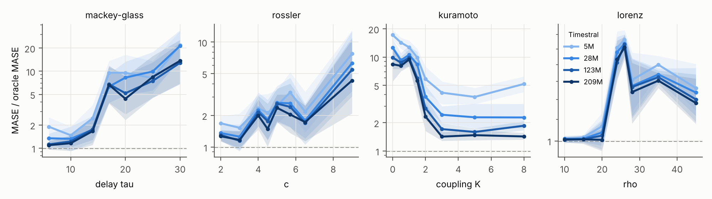
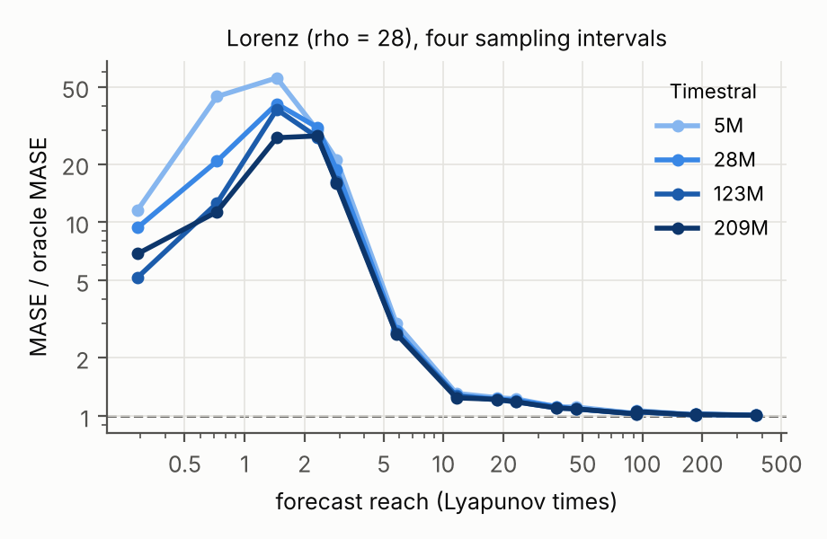
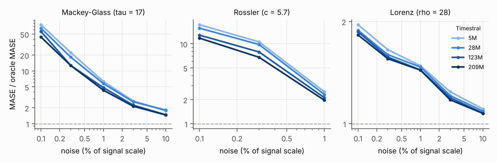
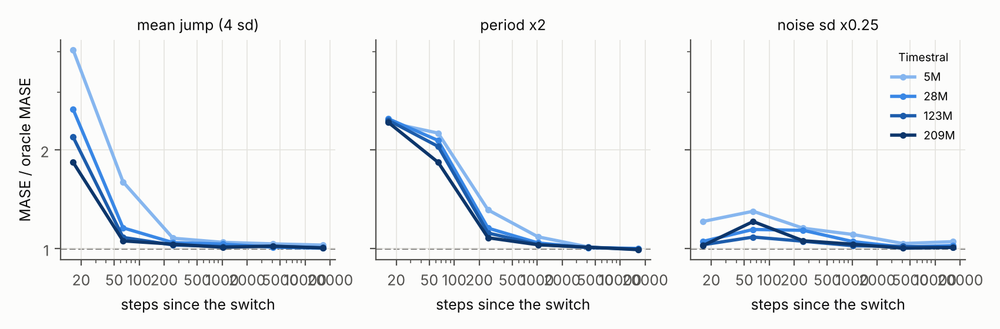
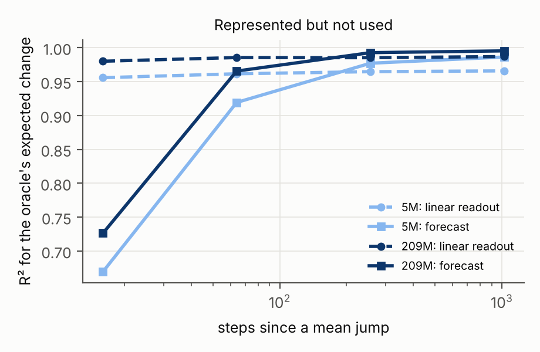

<!--
Writing rule for this file: every number must trace to a committed result file produced by a
committed script. Each number carries a pointer comment like <!-- src: results/... --> next to it.
Sections marked RESULTS-PENDING are filled only from those files.
-->

# 1. Introduction

Timestral is a family of open time-series foundation models (5M, 28M, 123M and 209M
parameters) released by Mistral on October 15, 2026. It forecasts up to 1,024 steps per
forward pass from up to 32,768 steps of history, outputs 21 quantiles per step, accepts
past-only and known-future covariates, and was pretrained mostly on synthetic data: simple
trend, seasonality and noise processes combined into multivariate series. Mistral reports
first place among pretrained and zero-shot models on GIFT-Eval, TIME and fev-bench.

A model trained on a synthetic distribution learns a prior over what series look like.
Benchmarks of real data measure how well that prior matches the series people happen to
collect. They do not say where the prior ends. This paper asks that question directly: we
build parameterized generators whose difficulty can be turned up smoothly, forecast them
with all four Timestral sizes, and measure the gap to forecasters that know the true
generating process. Then we look inside the model to explain the gaps, package the hard
cases as benchmarks, and test whether cheap fine-tuning closes them.

Contributions:

1. **A failure map** of Timestral across four signal families (chaos and dynamics, regime
   switches, heavy tails and fractal processes, and a learned mixture of primitives), along
   every difficulty knob, at four model sizes, four context lengths and horizons from 16
   steps to rollouts past one 1,024-step block, measured against a true-dynamics oracle and
   classical baselines.
2. **A covariate test** of Timestral's one-way covariate attention on coupled systems.
3. **A comparison of search methods** (CMA-ES, MAP-Elites quality-diversity, and gradient
   search through the model) for finding failures automatically.
4. **A mechanism analysis** with attention measurements on the forecast tokens and linear
   readouts of internal states.
5. **Two benchmarks** (a tagged diagnostic set and a leaderboard set) with generator code,
   seeds and a one-command evaluation.
6. **A fine-tuning study** comparing full fine-tuning, LoRA and data mixing under
   leave-one-family-out and held-out-knob protocols, with a regression check on normal series.

# 2. Setup

## 2.1 The model

Timestral is a causal patch transformer. A series is cut into patches of 32 steps; each
patch is normalized with the mean and standard deviation of everything observed up to the
end of that patch, squashed with `asinh`, and embedded. The sequence holds the context
patches followed by learned forecast tokens ("Decoupled Horizon Forecasting"): each forecast
token reads the whole context and the earlier forecast tokens, and a head maps it to 21
non-crossing quantiles for each of its 32 steps. Layers alternate attention over time with
attention across the variates of a series. Covariate rows are read by the main-series rows
but never read them. One forward pass covers up to 32 forecast patches (1,024 steps); longer
horizons are produced block by block, feeding each block's median back as context. The
released forecaster also averages the forecast of the series with the reflected forecast
of its negation ("symmetric averaging") and clips at zero when the context is non-negative.
We use the released code and weights with these defaults throughout.

Because a forecast block is causal across its forecast tokens, a forecast's first `h`
steps do not depend on the requested horizon beyond `h`. We checked that slicing a
1,024-step forecast reproduces separate shorter forecasts to float precision
(`tests/test_harness.py`), and evaluate all horizons up to the longest from one call.

## 2.2 References: what counts as a failure

A forecast error is only a failure relative to something that could have done better. We
use two references:

- **True-dynamics oracle.** Every generator is a simulator with an explicit state. To build
  a test case we simulate a warmup and the context, copy the final state 501 times, and
  advance every copy over the horizon with fresh noise. Copy 0 is the realized future; the
  other 500 form the oracle's predictive distribution, from which we take the same 21
  quantiles Timestral outputs. The oracle knows the equations, the parameters and the latent
  state at the forecast origin, so it is the best achievable forecast given that state (up
  to Monte Carlo error) and slightly stronger than anything that sees only the noisy
  observations. Deterministic systems get small dynamic noise and observation noise so the
  oracle's spread grows with the horizon instead of being zero.
- **Classical models.** Seasonal naive, ETS (additive error, damped trend, additive season
  when the period allows) and ARIMA (small order grid chosen by AIC), each turned into the
  same 21 quantiles from its Gaussian forecast distribution, fitted on the last 1,024 steps.

For every series we report the ratio of Timestral's error to the oracle's and to the best
classical model on that series, and the gap (difference) to the oracle.

## 2.3 Metrics

- **MASE**: mean absolute error of the median, divided by the in-sample mean absolute error
  of the seasonal naive forecast on the context.
- **sCRPS**: the continuous ranked probability score approximated by the average pinball
  loss over the 21 quantile levels (times 2), divided by the same scale as MASE.
- **Coverage and calibration**: the fraction of realized values inside the 80% and 98%
  intervals, and the mean absolute difference between each quantile level and the fraction
  of realized values below that quantile.
- **WQL** (GIFT-Eval's weighted quantile loss on levels 0.1 to 0.9), reported for the
  leaderboard only, since it divides by the series' magnitude and breaks near zero.

Ratios are aggregated over seeds by geometric mean, with 95% bootstrap intervals.

# 3. Signal families

Each family is a set of simulators with a difficulty knob (full definitions in
`otp/generators/`):

- **Chaos and dynamics**: Lorenz-63 (knob ρ through the onset of chaos; also the sampling
  interval), Rössler (knob c through period doubling), Mackey-Glass (knob: delay τ), the
  logistic map (knob r through the onset of chaos at about 3.57), and Kuramoto coupled
  oscillators (knob: coupling K through the synchronization threshold).
- **Regime switches**: jumps in mean, variance or seasonal frequency, placed inside the
  context at a chosen distance before the forecast origin or occurring in the horizon at a
  known hazard rate; and a Markov-switching AR process (knob: switching probability).
- **Heavy tails and fractal**: AR(1) and random walks with α-stable innovations (knob α),
  fractional Brownian motion (knob: Hurst exponent), a self-exciting (Hawkes) count process
  (knob: branching ratio), and a Markov-switching multifractal cascade (knob: number of
  multipliers).
- **Learned mixture of primitives**: a genome of four slots, each choosing one component
  (trend, season, AR noise, or any generator above), a weight, an additive or multiplicative
  role and three parameters, plus a global noise level (`otp/generators/mixture.py`). Search
  methods evolve genomes to maximize Timestral's error relative to the oracle while
  requiring the oracle to beat seasonal naive by a margin, so the series stays forecastable.
- **Controls**: in-prior series (random trend + season + AR noise, the kind of data Timestral
  was pretrained on).

# 4. Failure map

All ratios below are the geometric mean over seeds of Timestral's MASE divided by the
oracle's MASE on the same series, context and horizon (1.0 = as good as the true dynamics).
"vs best classical" divides by the best of seasonal naive, ETS and ARIMA on each series
instead. Unless stated otherwise: context 2,048 steps, horizon 128 steps, 8 seeds per setting.

## 4.1 Control: series like the training data

On random trend + season + AR-noise series (the kind Timestral was pretrained on), every size
stays within {{num:inprior_short_min}}–{{num:inprior_short_max}} of the oracle at horizons up
to 128 steps. The gap grows at long horizons:

{{table:inprior}}

Part of that long-horizon gap is not a prior failure: the oracle knows the exact trend slope
and seasonal shape, while any forecaster must estimate them from the context, and estimation
error in a slope grows linearly with the horizon. Family results are read against this control.

## 4.2 Chaos and dynamics

{{table:chaos_main}}

Timestral beats the best classical model on most of these systems (the 209M model's median
ratio to the best classical model across the chaos configs is
{{num:chaos_209m_vs_classical_median}}) and is still far from the oracle on smooth, nearly
deterministic oscillators: Mackey-Glass with long delays ({{num:chaos_mg30_5M}} at 5M,
{{num:chaos_mg30_209M}} at 209M for τ = 30), weakly coupled Kuramoto oscillators
({{num:chaos_kur1_5M}} and {{num:chaos_kur1_209M}} at K = 1), and the Rössler system
({{num:chaos_ros9_5M}} and {{num:chaos_ros9_209M}} at c = 9). Size matters for some of these
and not others: strongly coupled Kuramoto goes from {{num:chaos_kur8_5M}} at 5M to
{{num:chaos_kur8_209M}} at 209M, while the densely sampled Lorenz system stays at
{{num:chaos_lor_oe2_5M}} (5M) and {{num:chaos_lor_oe2_209M}} (209M). The chaotic logistic map
(r = 3.9), whose predictability is gone after a few steps, stays near 1 at every size.

**The gap lives inside the predictability horizon.** A Lyapunov time is how long it takes a
small error in a chaotic system to grow by a factor of e (for Lorenz at ρ = 28 the exponent is
{{num:lorenz_lyap}} per time unit). Putting four sampling intervals of the same Lorenz system
on that common axis shows that the ratio is set by how many Lyapunov times the forecast
reaches, not by the step count:

{{table:lorenz_lyap}}

Inside one to three Lyapunov times the oracle can still track the trajectory and Timestral
cannot; past about ten, nobody can, and the ratio returns to about 1. The noise level of the
generator sets how good the oracle can be inside that window. Sweeping the noise level
(dynamic and observation noise together) shows how much of each ratio that choice sets:

{{table:chaos_noise}}

At 0.1% noise the oracle is nearly exact and Mackey-Glass sits at
{{num:noise_mg_lo_min}}–{{num:noise_mg_lo_max}} times its error; at 10% the gap is
{{num:noise_mg_hi_min}}–{{num:noise_mg_hi_max}}. The ratio is therefore a measure of how much
predictable structure Timestral leaves unused, and its size depends on how much predictable
structure the generator provides. The ordering of model sizes holds at every noise level.

## 4.3 Heavy tails and fractal processes

Across α-stable AR processes and random walks, fractional Brownian motion, Hawkes counts and
multifractal cascades, all four sizes stay between {{num:tails_min}} and {{num:tails_max}} of
the oracle:

{{table:tails_main}}

Heavy tails and long memory, which a trend + season + Gaussian-noise description of series
does not cover, do not produce failures of the size seen for deterministic dynamics.

## 4.4 Regime switches

Three kinds of switch (a level jump, a change of seasonal period, a change of noise level) placed
a chosen number of steps before the forecast origin, so the context shows the switch:

{{table:regime}}

The failure is concentrated right after a switch. Sixteen steps after a level jump of 4 noise
standard deviations, the error is {{num:reg_mj4_16_5M}} times the oracle's at 5M and
{{num:reg_mj4_16_209M}} at 209M; a thousand steps later it is {{num:reg_mj4_1024_5M}} and
{{num:reg_mj4_1024_209M}}. Period changes last longer: 64 steps after the period triples, the
ratio is still {{num:reg_fj3_64_5M}} (5M) and {{num:reg_fj3_64_209M}} (209M). A direct measure of
how much of a level jump the forecast adopts (1 = forecasts at the new level, like the oracle;
0 = still at the old level), over the first 16 forecast steps and pooled over jump sizes, is
{{num:adopt_5M_16}} / {{num:adopt_5M_64}} / {{num:adopt_5M_256}} at 16 / 64 / 256 steps after the
switch for 5M and {{num:adopt_209M_16}} / {{num:adopt_209M_64}} / {{num:adopt_209M_256}} for 209M.
Section 7.3 shows that the change is nevertheless represented inside the model.

When the switch happens during the horizon at a known rate (so nobody can see it coming),
Timestral stays at {{num:reg_horizon_min}}–{{num:reg_horizon_max}} of the oracle, and on
Markov-switching AR processes at {{num:reg_markov_min}}–{{num:reg_markov_max}}.

## 4.5 Does more history help?

All four sizes with contexts up to 32,768 steps (Colab job B, 28 settings × 8 seeds):

{{table:long_ctx}}

More history helps on Mackey-Glass (τ = 17: {{num:long_mg17_5M_T2048}} → {{num:long_mg17_5M_T32768}}
for 5M and {{num:long_mg17_209M_T2048}} → {{num:long_mg17_209M_T32768}} for 209M from 2,048 to
32,768 steps) and slightly on Rössler and Lorenz; it does not help on the in-prior control,
which gets slightly worse at 32,768 steps. {{num:long_nonfinite_oracle_samples}} samples
(Rössler, c = 5.7) had oracle paths that left the attractor at long horizons; their oracle
ratios are excluded.

# 5. Covariates and one-way attention

RESULTS-PENDING.

# 6. Searching for failures

RESULTS-PENDING.

# 7. Why it fails

## 7.1 Two suspects that turned out innocent

**Symmetric averaging.** The released forecaster averages its forecast of the series with the
mirrored forecast of the negated series. That forces a symmetric treatment of asymmetric
processes (bursty counts, one-sided maps), so it was a natural suspect. Turning it off changes
the sCRPS ratio to the oracle by a factor between {{num:symavg_min}} and {{num:symavg_max}}
across 14 settings and both small sizes: it is not where the failures come from.

**Cumulative normalization.** Timestral normalizes every patch with the mean and spread of
everything since the start of the context, so old history keeps weighing on the scale after a
regime switch. After a variance drop 64 steps back, intervals are indeed far too wide (80%
intervals cover at least {{num:norm_vdrop_cov80_min}} of points; sCRPS ratio
{{num:norm_vdrop_scrps_min}}–{{num:norm_vdrop_scrps_max}}). But cutting the context down to
the post-switch part, which removes the old history from the statistics entirely, lowered the
sCRPS ratio in only {{num:norm_post_better}} of {{num:norm_cells}} cells (those with at least
256 post-switch steps) and raised it in the rest. The anchoring is not the main cause.

## 7.2 Template or retrieval?

For a deterministic system, the context itself is a library of past trajectories: find the
moments whose recent history looks most like the present and see what happened next (the
"method of analogues", a few lines of nearest-neighbour code with no training). A second
context-only forecaster continues the series as a periodic pattern (the average of its last
cycles at the dominant period). On the chaos family (MASE, lower is better):

{{table:analog}}

The method of analogues beats every Timestral size on Mackey-Glass and Rössler and loses to
Timestral on weakly coupled Kuramoto and on Lorenz. Timestral's forecasts correlate more with the analogue forecast
than with the periodic template, but lean toward the template more than the oracle does
(`results/mechanism/analog/summary.csv`). Our reading: Timestral uses the context partly as a
trajectory library and partly as a pattern to repeat, and on smooth nonlinear oscillators,
which its trend + season + noise prior represents as near-periodic, the second pull wins.

## 7.3 Inside the model: represented but not used

For each setting we ran one plain forward pass on 300 samples and asked two questions about
the oracle's expected change over the first forecast patch (and at single steps 1 and 16):
how well does Timestral's own forecast predict it, and how well does a linear readout (a
ridge regression, cross-validated) of the hidden state of the first forecast token predict
it, at the best layer? If the readout does much better than the output, the information the
oracle uses is inside the model but does not reach the forecast. The readout is a lower bound
on what is linearly present: with 300 samples and 192–768 features per token, the ridge fit
loses some signal, which shows on the in-prior control, where it scores
{{num:ro_ip_ro_min}}–{{num:ro_ip_ro_max}} against {{num:ro_ip_out_min}}–{{num:ro_ip_out_max}}
for the output. Gaps in the readout's favour are therefore conservative.

{{table:readouts}}

**Recent regime switches: represented, attended to, not used.** Sixteen steps after a mean
jump, the readout reaches R² {{num:ro_mj16_ro_min}}–{{num:ro_mj16_ro_max}} at every size while
the forecast itself reaches {{num:ro_mj16_out_min}}–{{num:ro_mj16_out_max}}, and the forecast
error is {{num:ro_mj16_ratio_min}}–{{num:ro_mj16_ratio_max}} times the oracle's. The forecast
tokens are not looking elsewhere: they put {{num:ro_mj16_post_min}}–{{num:ro_mj16_post_max}}
times their proportional share of attention on the post-switch patches. Sixty-four steps
after a frequency jump, one step ahead, the readout reaches {{num:ro_fj64_s1ro_min}}–{{num:ro_fj64_s1ro_max}}
against {{num:ro_fj64_s1out_min}}–{{num:ro_fj64_s1out_max}} for the output. By 256 steps after
a mean jump the two agree ({{num:ro_mj256_out_min}}–{{num:ro_mj256_out_max}} vs.
{{num:ro_mj256_ro_min}}–{{num:ro_mj256_ro_max}}). The model sees and encodes a recent change and
then forecasts as if it may not last. Our interpretation, which we cannot check without the
pretraining data: if lasting breaks are rare in the synthetic trend + season + noise mix, a very
recent departure from the pattern is better explained as noise under that prior than as a new
regime.

**Deterministic oscillators: the gap builds later.** On Mackey-Glass (τ = 17) output and readout
agree for the first patch ({{num:ro_mg17_out_min}}–{{num:ro_mg17_out_max}} vs.
{{num:ro_mg17_ro_min}}–{{num:ro_mg17_ro_max}}): the near-term forecast uses what is there, and the
error accumulates over the following cycles. There the forecast correlates with a periodic
continuation of the context more than the oracle's forecast does
({{num:ro_mg17_tm_5M}} at 5M, {{num:ro_mg17_tm_209M}} at 209M, against
{{num:ro_mg17_to_min}} for the oracle), and the excess shrinks with size together with the error.

# 8. Benchmarks

The failure map is released as two benchmark sets built from the same simulators (code and data in
`bench/`). Each series comes with the oracle's 21 quantiles, so a model is scored against the best
achievable forecast as well as against seasonal naive, the GIFT-Eval convention.

**OffPrior-Diag** has {{num:bench_n_diag}} series: {{num:bench_nconf_diag}} configs with 12 seeds each, at
context 2,048 and horizon 128. Every config was picked to cover one failure type from Sections 4 and 7,
or to serve as a control (inside the prior, an old switch, a switch inside the horizon that nobody can
see coming, a map nobody can forecast); each series carries its failure type and a one-line reason.
**OffPrior-LB** has {{num:bench_n_lb}} series: every config of the chaos, regime, tails and in-prior
grids, 40 fixed random mixture genomes and four more in-prior periods ({{num:bench_nconf_lb}} configs), 16 seeds per config spread
over contexts 512 / 2,048 / 8,192 and horizons 16 / 128 / 1,024, split into public and held-out halves by
seed parity. The seeds and code are public, so the held-out half is a convenience, not a secret test set.
`bench/eval.py` scores one model in one command; the summary is the geometric mean over series of MASE
and sCRPS divided by seasonal naive's, and of MASE divided by the oracle's.

{{table:bench_diag}}

{{table:bench_lb}}

On OffPrior-Diag, Timestral's MASE is {{num:bench_diag_209M_oracle}}× the oracle's at 209M and
{{num:bench_diag_5M_oracle}}× at 5M, against {{num:bench_diag_ets_oracle}}× for ETS,
{{num:bench_diag_arima_oracle}}× for ARIMA and {{num:bench_diag_seasonal_naive_oracle}}× for seasonal naive.
On OffPrior-LB the same ratios are {{num:bench_lb_209M_oracle}}× and {{num:bench_lb_5M_oracle}}× for Timestral,
and {{num:bench_lb_ets_oracle}}×, {{num:bench_lb_arima_oracle}}× and
{{num:bench_lb_seasonal_naive_oracle}}× for the classical models. By family on OffPrior-LB, 209M is at
{{num:bench_lb_fam_chaos}}× the oracle on chaos, {{num:bench_lb_fam_mixture}}× on the mixture genomes and
{{num:bench_lb_fam_tails}}× on tails.

{{table:bench_diag_ft}}

By failure type, the diagnostic set reproduces the map at 209M: coupled oscillators
({{num:bench_ft_coupled_oscillators}}×), delay oscillators ({{num:bench_ft_delay_oscillator}}×), chaos within the
first Lyapunov times ({{num:bench_ft_chaos_short_reach}}×), smooth chaos ({{num:bench_ft_smooth_chaos}}×) and
recent switches ({{num:bench_ft_recent_switch}}×), while the controls and the heavy-tailed, bursty and
multifractal types stay at {{num:bench_ft_ctrl_min}}–{{num:bench_ft_ctrl_max}}×.

The published files were built on a Windows laptop. A rebuild on Linux with newer NumPy matched them
array-for-array for {{num:bench_xp_same}} of {{num:bench_xp_n}} diagnostic configs; in the others
(Mackey-Glass, Kuramoto near synchronization, and one fractional Brownian motion setting) platform
floating-point differences change the simulated paths, and the chaotic ones diverge. Scores should
therefore be reported on the published files (`bench/data/cross_platform_diag.json` has the per-config
comparison).

# 9. Fixing it

## 9.1 Without training: let the context decide

Section 7.2 showed that a nearest-neighbour forecaster built from the context beats Timestral
on some deterministic systems and loses badly on others. A forecaster can find out which case
it is in from the context alone: forecast the last stretch of the context from what comes
before it, with both methods, and compare. The rule we test switches to the analogue forecast
(keeping Timestral's quantile spread around the new median) only when the analogues' backtest
error is below 0.7 times Timestral's on each of the last two 128-step windows.

How the rule was chosen matters. A first pre-set procedure (tune on even seeds, report on odd
seeds) picked a one-window rule that helped chaos but cost the tails family
{{num:sv_firstrule_tails_min}}–{{num:sv_firstrule_tails_max}} on the held-out seeds. We then
picked the two-window rule from that held-out table, which is a choice made after seeing
it, so we froze it and evaluated it once more on fresh samples generated for that purpose
(`results/fix/README.md` lists all three stages). On the fresh samples (MASE of the fix divided
by Timestral's MASE; below 1 is better):

{{table:selfval}}

The fix improves chaos by a factor of {{num:sv_chaos_5M}} at 5M and {{num:sv_chaos_209M}} at
209M, leaves in-prior and regime series untouched (the rule never switches there), and costs at
most a factor of {{num:sv_tails_max}} on tails. Its benefit shrinks with model size, in line with
larger models closing more of the chaos gap on their own.

The other zero-training idea, cutting the context to the part after a detected change
(Section 7.1), helps only when at least 256 post-switch steps are available.

## 9.2 Fine-tuning: full, LoRA, and data mixing

RESULTS-PENDING.

# 10. Limitations

- **The oracle knows the latent state.** It is the best forecast given the true state, which
  is stronger than the best forecast given only the observed history. Ratios to it therefore
  bound the possible improvement from above; part of every gap is unavoidable for any
  forecaster that sees only the data.
- **Noise sets the size of chaos gaps.** For nearly deterministic systems the oracle's error,
  and so every ratio to it, depends on the noise level we chose (1% by default); Section 4.2
  reports the dependence. Orderings (between settings and between model sizes) are more
  robust than the magnitudes.
- **Seeds.** Most settings use 8 seeds (16 for the noise sweep, 300 samples per setting for
  the mechanism runs). Intervals in the result files are bootstrap intervals over seeds; with
  8 seeds they are wide for heavy-tailed settings.
- **Diverged simulations.** A few Rössler simulations left the attractor under noise; their
  oracle could not be scored and they are excluded (counts are given where they occur).
- **Univariate main series.** Except for the covariate study, every test series is a single
  variate.
- **No access to the pretraining data.** Statements about what the synthetic prior contains
  are inferences from behaviour, labelled as such.
- **Compute.** Small-model sweeps ran on a 2-core CPU VM; the large-model sweeps, the
  long-context runs and the mechanism runs at all sizes ran on Colab A100 GPUs; one mechanism
  test ran on a laptop RTX 3060 GPU. GPU and CPU forecasts of the same series agree to a few
  parts in 100,000 in MASE (`results/mechanism/analog/parity_vm_cpu_vs_laptop_gpu.json`).

# Reproducibility

All code, generator seeds and result files are in the repository. Every number above
points to the result file it comes from; every result file has a `provenance.json` naming
the script, the commit, the host and the wall time.
